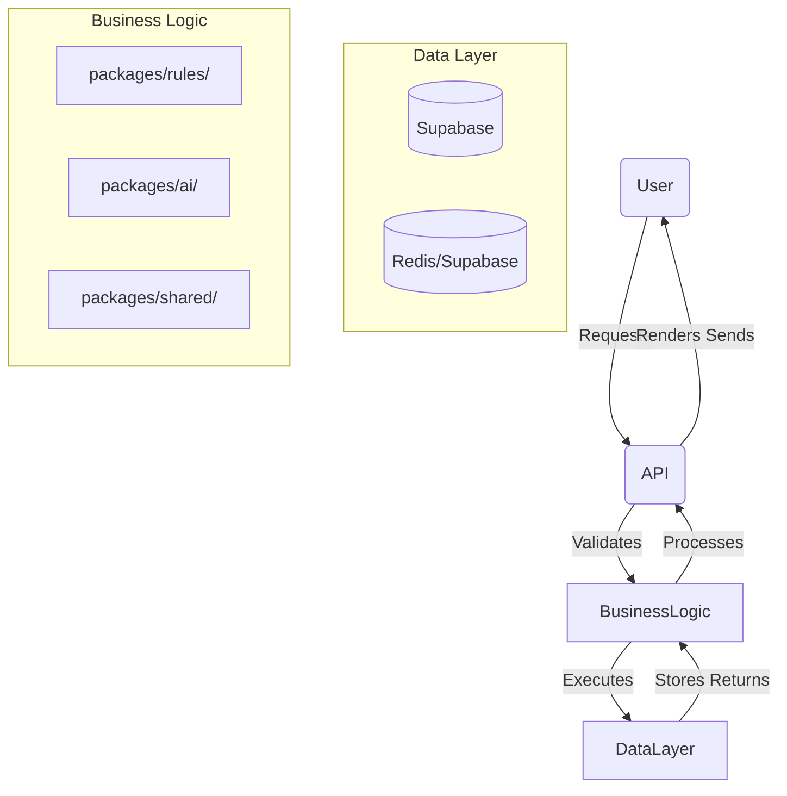
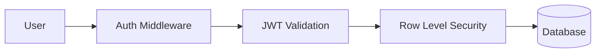
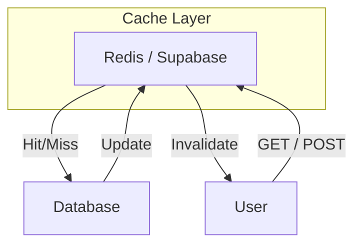
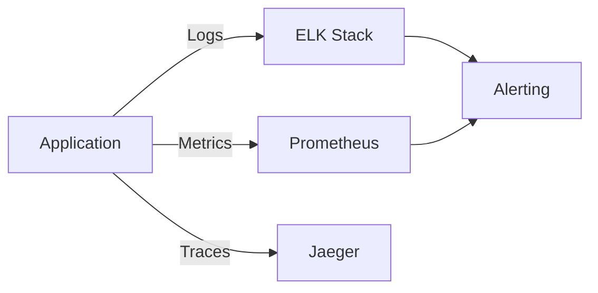
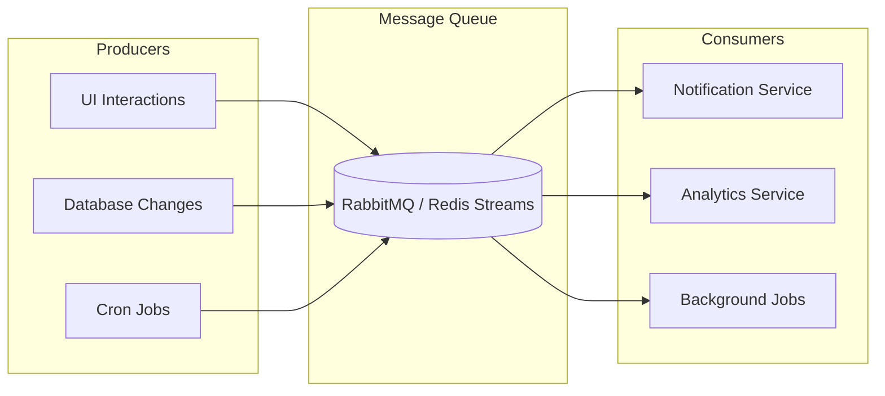

# LifeOS — Qatlamlar va Oqimlar

> Asosiy qatlamlar va ular o'rtasidagi ma'lumotlar oqimlarini tavsiflovchi diagramma va tavsiflarni o'z ichiga oladi.

---

## 🏗️ 5-Qatlamli Arxitektura

```
┌─────────────────────────────────────────────────────────┐
│           1️⃣ USER LAYER (Frontend)                     │
│ ┌─────────────────────────────────────────────────────┐ │
│ │ ☐ Web App (Next.js, React Server Components)         │ │
│ │ ☐ PWA (Progressive Web App)                          │ │
│ │ ☐ MCP Client (Claude Desktop)                       │ │
│ │ ☐ Mobile App (React Native)                         │ │
│ │ ☐ Telegram Bot (REST/Webhook)                        │ │
│ └─────────────────────────────────────────────────────┘ │
│  ↘️ Direct User Interaction ↔️ Authentication & State     │
└─────────────────────────────────────────────────────────┘
                                 ↘️ API/GraphQL

┌─────────────────────────────────────────────────────────┐
│          2️⃣ API LAYER (Server Layer)                    │
│ ┌─────────────────────────────────────────────────────┐ │
│ │ ☐ Edge Functions (Supabase)                           │ │
│ │ ☐ Next.js Routes (Server Actions)                    │ │
│ │ ☐ Internal Services (Express/Koa)                    │ │
│ │ ☐ Cache Layer (Redis, Supabase)                      │ │
│ │ ☐ Rate Limiting & Authentication                   │ │
│ └─────────────────────────────────────────────────────┘ │
│  ↘️ Business Logic ↔️ Data Access                          │
└─────────────────────────────────────────────────────────┘
                                 ↗️ Database

┌─────────────────────────────────────────────────────────┐
│          3️⃣ BUSINESS LOGIC (App Logic)                   │
│ ┌─────────────────────────────────────────────────────┐ │
│ │ ☐ packages/rules/ (XP, SM-2, Life Score)             │ │
│ │ ☐ packages/ai/ (agents, tools, prompts)              │ │
│ │ ☐ packages/shared/ (types, constants, utils)         │ │
│ │ ☐ packages/db-types/ (Drizzle schemas)               │ │
│ │ ☐ Business Services (Gamification, Analytics)       │ │
│ └─────────────────────────────────────────────────────┘ │
│  ↘️ Use Cases ↔️ Business Rules                             │
└─────────────────────────────────────────────────────────┘
                                 ↗️ packages

┌─────────────────────────────────────────────────────────┐
│          4️⃣ DATA LAYER (Storage)                         │
│ ┌─────────────────────────────────────────────────────┐ │
│ │ ☐ Database (PostgreSQL via Supabase)                 │ │
│ │ ☐ Cache (Redis, Supabase)                            │ │
│ │ ☐ File Storage (S3, Supabase Storage)                │ │
│ │ ☐ Analytics (BigQuery, custom views)                 │ │
│ │ ☐ Search (PostgreSQL, pgvector)                      │ │
│ └─────────────────────────────────────────────────────┘ │
│  ↘️ Data Models ↔️ Persistence                             │
└─────────────────────────────────────────────────────────┘
                                 ↗️ tables

┌─────────────────────────────────────────────────────────┐
│          5️⃣ INFRASTRUCTURE (DevOps)                      │
│ ┌─────────────────────────────────────────────────────┐ │
│ │ ☐ CI/CD (GitHub Actions, Vercel)                      │ │
│ │ ☐ Monitoring (Prometheus, Grafana)                    │ │
│ │ ☐ Logging (ELK, Sentry)                              │ │
│ │ ☐ Secrets Management (Vault, .env)                   │ │
│ │ ☐ Infrastructure as Code (Terraform, Docker Compose) │ │
│ └─────────────────────────────────────────────────────┘ │
└─────────────────────────────────────────────────────────┘

---

## 🔗 Main Data Flow



---

## 📊 Layer-by-Layer Flow

### 1️⃣ User Layer → API Layer
**Client → Server** communication:

1. **HTTP/REST + GraphQL**
   - Next.js API routes (GET/POST/PUT/DELETE)
   - Edge Functions (Supabase) for AI and Telegram

2. **Authentication**
   - JWT tokens (Supabase)
   - Session management (Zustand, Next.js)
   - RLS policies on Supabase

3. **Caching**
   - React Query (server-side caching)
   - Supabase realtime (WebSocket)
   - Redis for frequently read data

### 2️⃣ API Layer → Business Logic
**Server → Business Logic** validation:

1. **Validation**
   - Zod schema (Zod from packages/shared)
   - Rate limiting (Supabase)
   - Rate limiting (Supabase)

2. **Authorization**
   - Role-based access (users can only see own data)
   - API keys for external services (Telegram, Anthropic)

3. **Business Rules**
   - XP calculation (packages/rules/xp.ts)
   - SM-2 algorithm (packages/rules/sm2.ts)
   - Life Score formula (packages/rules/life-score.ts)
   - Achievement checking (packages/rules/achievements.ts)

### 3️⃣ Business Logic → Data Layer
**Logic → Database** interaction:

1. **Database Operations**
   - Drizzle ORM (typesafe)
   - Raw SQL (complex queries)
   - pgvector for semantic search

2. **Transactions**
   - ACID compliance
   - Race condition prevention
   - Deadlock avoidance

3. **Events**
   - Postgres notifications (realtime)
   - Background jobs (queues)

### 4️⃣ Data Layer → Business Logic
**Database → Logic** processing:

1. **Business Logic**
   - Business rules implementation
   - Business rules implementation

2. **Cache Invalidation**
   - Cache invalidation (Redis)
   - Supabase realtime

3. **Data Transformation**
   - DTO/VO patterns
   - Pagination
   - Filtering

### 5️⃣ Infrastructure
**DevOps & Dev Tools**

1. **CI/CD**
   - GitHub Actions
   - Vercel (web)
   - Docker

2. **Observability**
   - Prometheus + Grafana (metrics)
   - ELK stack (logs)
   - Sentry (errors)

3. **Secret Management**
   - HashiCorp Vault (cloud)
   - .env files (development)
   - Vercel Environment Variables (production)

---

## 🔀 Cross-Cutting Concerns

### Authentication & Security


1. **Multi-Factor Authentication**
   - Email/Password + OAuth (Google, GitHub)
   - 2FA (TOTP)

2. **Data Protection**
   - Encryption at rest
   - Encryption in transit
   - Audit logging

3. **Rate Limiting**
   - IP-based (5000 req/hour)
   - User-based (100 req/minute)
   - API endpoint-based

### Caching Strategy


1. **Cache Types**
   - **Cache** (Frequently read data)
   - **Session Cache** (User session data)
   - **Application Cache** (App settings, lists)

2. **Cache Keys**
   - `user:{userId}:data`
   - `cache:{queryHash}`
   - `session:{sessionId}`

3. **Invalidation**
   - Write-through
   - Write-behind
   - Time-based (TTL)

### Observability


1. **Logging**
   - Structured logs (JSON)
   - Correlation IDs (request IDs)
   - Log retention (30 days)

2. **Metrics**
   - Application metrics (CPU, memory)
   - Business metrics (user growth, activity)
   - System metrics (database, cache)

3. **Alerting**
   - Critical alerts (error rate, downtime)
   - Warning alerts (high latency, high memory)
   - Notification channels (email, Slack)

---

## 🔄 Integration Patterns

### Event-Driven Architecture


### Event Types
1. **Domain Events**
   - `task_completed`
   - `habit_completed`
   - `xp_gained`
   - `goal_progress`

2. **System Events**
   - `user_signup`
   - `api_rate_limit`
   - `error_occurred`

3. **Integration Events**
   - `telegram_message_received`
   - `notion_page_created`
   - `obsidian_note_created`

### Event Processing
```ts
// packages/shared/events.ts
export const EventTypes = {
  TASK_COMPLETED: 'task_completed',
  HABIT_COMPLETED: 'habit_completed',
  USER_SIGNED_UP: 'user_signed_up',
  // ...
}

export interface Event {
  type: string
  userId: string
  data: any
  timestamp: Date
}
```

---

## 📈 Scalability Considerations

### Vertical Scaling
1. **Database Sharding**
   - User-based sharding (current design)
   - Read replicas
   - Connection pooling

2. **Caching**
   - Redis cluster
   - CDN for static assets

3. **Application Scaling**
   - Load balancing
   - Horizontal scaling

### Horizontal Scaling
1. **Stateless Services**
   - Edge Functions
   - Next.js workers

2. **Database Replication**
   - Read replicas
   - Materialized views

3. **Message Queue Scaling**
   - Partitioned queues
   - Dead letter queues

---

## 🛡️ Security Layers

### Defense in Depth
```mermaid
sidebar
    subgraph "Layer 1"
        Authentication[Authentication]
    end
    subgraph "Layer 2"
        Authorization[Authorization]
    end
    subgraph "Layer 3"
        Network[Network Security]
    end
    subgraph "Layer 4"
        Data[Data Protection]
    end
    subgraph "Layer 5"
        Monitoring[Monitoring & Response]
    end
```

1. **Network Layer**
   - HTTPS with TLS 1.3
   - Firewall rules
   - DDoS protection

2. **Application Layer**
   - Input validation
   - Output encoding
   - Session management

3. **Database Layer**
   - Encryption
   - Access control
   - Auditing

4. **Monitoring Layer**
   - Anomaly detection
   - Threat detection
   - Incident response

---

## 🔄 Data Flow Analysis

### High-Level Flow (New User)
```
1. Registration
   ├── Frontend: Sign up form
   ├── Validation: Zod schema
   ├── Database: Create user record
   ├── Cache: User profile
   └── Response: Success

2. Daily Usage
   ├── Open App
   ├── Get authentication token
   ├── Fetch user data (from cache)
   ├── Render dashboard
   └── Update last active timestamp

3. Task Creation
   ├── UI: Form input
   ├── Validation: Server-side
   ├── Business Rules: XP calculation
   ├── Database: Insert task
   ├── Cache: Invalidation
   └── Real-time Update: Other users (optional)
```

### Performance Characteristics
1. **Database Queries**
   - Average response time: <50ms
   - Connection pooling: 10-20
   - Query optimization: Index usage

2. **API Latency**
   - Cache hit: <5ms
   - Cache miss: 50-200ms
   - External API: 100-500ms

3. **Processing**
   - Synchronous: <100ms
   - Asynchronous: Background

---

## 🔄 Technical Debt Management

### Debt Types
1. **Technical Debt**
   - Code smell
   - Poor architecture
   - Missing tests

2. **Process Debt**
   - Poor documentation
   - Inadequate review
   - No CI/CD

### Debt Management
```bash
# Debt tracking (ISO 25010)
# Functional suitability
# Performance
# Security
# Maintainability
# Reliability
```

### Debt Repayment
1. **Prioritization**
   - Impact x Frequency
   - Critical vs Nice to have
   - Debt-to-equity ratio

2. **Repayment Strategies**
   - Refactor in next sprint
   - Incremental debt reduction
   - Complete rewrite (if justified)

---

## 🎯 Technology Choices

### Frontend
| Technology | Version | Reason |
|------------|---------|--------|
| Next.js | 15 | Server Components, routing |
| React | 19 | Performance, concurrent features |
| TypeScript | 5 | Type safety |
| Tailwind CSS | 3 | Styling |
| shadcn/ui | 1 | UI components |

### Backend
| Technology | Version | Reason |
|------------|---------|--------|
| Supabase | Latest | PostgreSQL + Edge Functions |
| Drizzle ORM | 0.24 | Typesafe queries |
| PostgreSQL | 14+ | ACID compliance |
| pgvector | Latest | Semantic search |

### AI
| Technology | Version | Reason |
|------------|---------|--------|
| Anthropic Claude | 3.5 Sonnet | Best performance/price ratio |
| Whisper | Latest | Voice-to-text |
| OpenAI | Latest | Fallback |

---

## 🔄 Future Migration Paths

### Phase 1 (Current)
- Monolithic architecture
- Direct database access
- Single deployment

### Phase 2 (Next)
- Microservices (Event-driven)
- GraphQL API (alternative to REST)
- Edge caching (Cloudflare Workers)

### Phase 3 (Future)
- Serverless functions
- Kubernetes orchestration
- Multi-region deployment

---

Bu ARCHITECTURE.md — barcha qatlamlar va ular o'rtasidagi oqimlar haqida to'liq tavsif. Keyingi qadamda DATA_MODEL.md va AI_AGENTS.md yoziladi.
